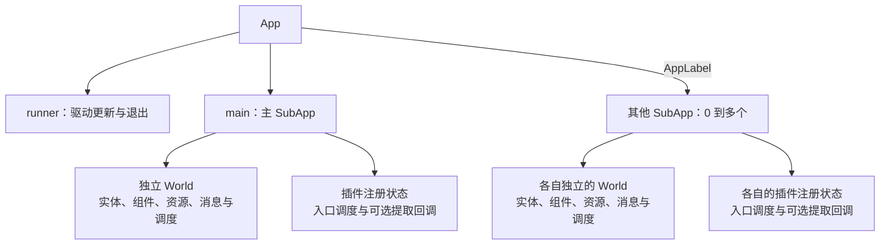
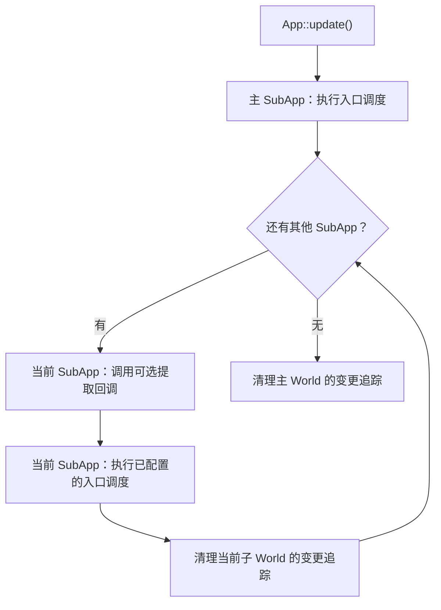
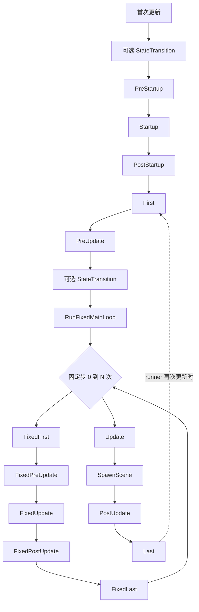

# Bevy App 与项目模块

Bevy 的 `App` 组织应用的 ECS 世界与运行流程。`World` 保存实体、组件和资源；System 读取或修改这些数据，Schedule 组织系统的执行。Plugin 可以向 `App` 注册资源、系统及其他配置，便于组合功能。Plugin 的安装顺序不等于系统的执行顺序；系统顺序需要通过调度依赖明确表达。

`App::update` 推进一次应用更新；`App::run` 将控制权交给配置的 runner，由 runner 决定如何驱动更新与退出。窗口和事件循环取决于安装的插件及 runner，不能仅凭创建 `App` 推断窗口行为。

## App 与 SubApp

### 包含结构与 World 边界

一个 `App` 管理 runner 和一组 `SubApp`。主应用本身也是一个 `SubApp`，保存在 `main` 中；其他子应用通过 `AppLabel` 标识。每个 `SubApp` 拥有独立的 `World`、插件注册状态、入口调度配置和可选的数据提取回调。

不同世界中的实体、组件、资源和消息不会因为属于同一个 `App` 就自动共享。系统的 `Query`、`Res` 等参数访问其运行所在的 `World`；在两个世界中表示同一业务对象时，需要显式维护实体映射，传输数据需要显式提取或其他通信机制。相同的资源类型可以在两个世界中保存不同实例，也可以由插件显式放入指向共享对象的句柄。

`App::world()`、`insert_resource()` 和 `add_systems()` 等常用接口默认操作主 `SubApp`。配置其他子应用时，通过 `get_sub_app_mut(label)` 等接口取得目标，再向它的世界和调度注册内容。Plugin 的构建入口接收 `App`，因此插件既可以配置主应用，也可以创建或配置其他子应用；插件不等于子应用。

### 更新与数据提取

`App::new()` 为主应用安装 `MainSchedulePlugin`，将入口调度设为 `Main`。`SubApp::new()` 的 `update_schedule` 默认为 `None`，不会自动获得整套主调度生命周期。要由 `SubApp::update()` 执行其系统，需要配置并指定入口调度；仅向某个调度注册系统不会启用该入口。

普通 `App::update()` 先运行主应用的入口调度，然后逐个处理其他子应用：先调用其提取回调，再执行其入口调度。其他子应用存放在按标签索引的集合中，不保证按插入顺序执行，不能把子应用的插入顺序作为更新依赖。

`set_extract` 注册的回调同时获得主 `World` 和当前子 `World` 的可变访问，用于选择性复制、转换或传递所需数据。接口允许修改两个世界，不强制只读来源或单向复制；具体同步哪些实体、组件和资源，由回调及相关插件决定。未配置回调时提取步骤不做任何操作；单独调用 `SubApp::update()` 也不会自动调用提取回调。

`SubApp` 是世界与调度的组织边界，本身没有独立 runner，也不代表线程或进程。上述普通更新路径依次处理子应用；系统并行及跨线程运行由调度器或具体插件另行安排。

### 渲染例子

渲染使用这一机制分离模拟状态与渲染处理所需的数据。`RenderPlugin` 在渲染后端可用时建立由 `RenderApp` 标识的子应用；主世界保存模拟状态，渲染世界保存提取后用于渲染处理的数据。渲染提取设施通过 `ExtractSchedule` 等机制显式同步所需实体、组件和资源，具体同步规则由渲染插件提供。

启用流水线渲染时，`PipelinedRenderingPlugin` 将 `RenderApp` 移出普通子应用集合，交给渲染线程更新；主线程中的 `RenderExtractApp` 负责等待、提取与交接，使模拟与渲染可以部分重叠。这种线程安排属于渲染插件，不能用上面的普通更新顺序概括所有渲染配置。

## 主调度生命周期

Bevy 0.20 主 `SubApp` 的默认入口 `Main` 首次运行启动阶段，随后每次更新运行帧阶段。状态功能启用并安装相应插件时，`StateTransition` 参与启动和每帧调度；安装 `TimePlugin` 等默认时间设施时，`RunFixedMainLoop` 根据经过的时间运行零次或多次 `FixedMain`。图示默认顺序，调度可以扩展，具体系统顺序还取决于配置。

`FixedMain` 每次按 `FixedFirst`、`FixedPreUpdate`、`FixedUpdate`、`FixedPostUpdate`、`FixedLast` 的顺序运行。

## 本项目模块

| 模块 | Plugin | 职责与详细架构 |
| --- | --- | --- |
| game_flow | `GameFlowPlugin` | [应用状态、时钟与跨功能调度](game_flow.md)。 |
| first_person | `FirstPersonPlugin` | [动作、控制关联、捕获与相机](first_person.md)。 |
| character | `CharacterPlugin` | [角色身份、意图、接地与运动](character.md)。 |
| item_interaction | `ItemInteractionPlugin` | [拾取、共享刚体持握与释放](item_interaction.md)。 |
| physics | `GamePhysicsPlugin` | [Avian、重力与碰撞](physics.md)。 |
| [scene_assembly](../../src/scene_assembly/mod.rs) | `SceneAssemblyPlugin` | 以 BSN 装配程序生成的平地、玩家、控制者、相机、灯光和三个方块。 |
| ui | `GameUiPlugin` | [页面、菜单、控件与背景](ui.md)。 |
| settings | `GameSettingsPlugin` | [设置、草稿、原型参数与限帧](settings.md)。 |
| audio | `GameAudioPlugin` | [声音请求、混音与设备输出](audio.md)。 |
| inspector | `InspectorPlugin` | [世界检查器](inspector.md)。 |
| session_log | `SessionLogPlugin` | [会话日志](session_log.md)。 |
| window_policy | `WindowPolicyPlugin` | [原生窗口策略](window_policy.md)。 |
| acceptance | `AcceptancePlugin` | [验收构建的原生 BRP 接入](acceptance.md)。 |
