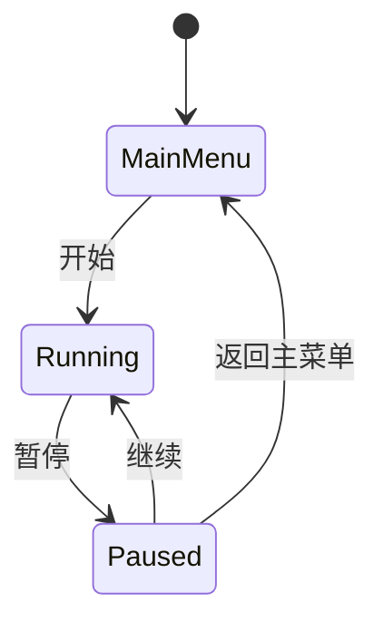
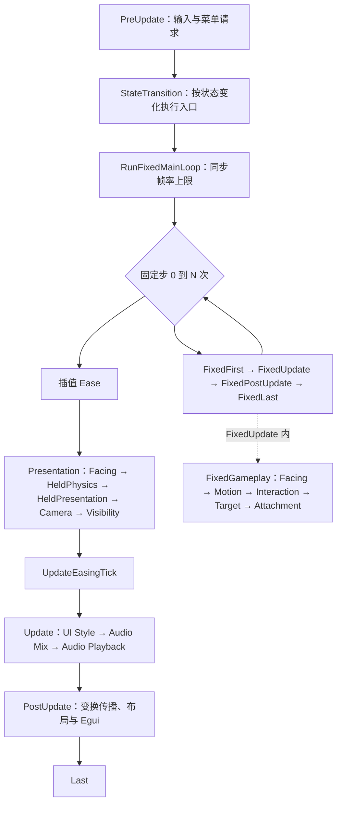

# 应用流程架构

源码入口见 [game_flow/mod.rs](../../src/game_flow/mod.rs)。

## 菜单与会话生命周期

场景在离开主菜单时装配；无应用状态的最小测试在 `Startup` 复用入口。控制者通过关系组件关联角色和一台第一人称相机；关联细节见[第一人称架构](first_person.md)，场景尺寸与可见边界见[灰盒场景](../player-guide.md#灰盒场景)。

`AppState` 是应用运行状态的唯一来源。暂停保留场景实体和持有关系，返回主菜单时通过 `DespawnOnEnter(AppState::MainMenu)` 清理场景根，视觉子树沿 `ChildOf` 清理；再次开始创建新场景。

进入暂停时，角色清空意图，第一人称停用玩法输入并释放鼠标，UI 切换暂停页；`GameFlowPlugin` 暂停 `Time<Virtual>` 和 `Time<Physics>` 并立即清零物理增量。主菜单中虚拟时间推进、物理时间暂停。恢复时重新启用时间和捕获，捕获当帧跳过自由光标位移。玩法及显示同步由 `gameplay_running` 门控，捕获检查仍执行；没有应用状态的最小测试允许独立玩法系统执行。

## 时钟与运行条件

固定玩法模拟由 `Time<Fixed>` 配置为 60 Hz；[设置](settings.md)管理的渲染帧率限制与固定模拟频率独立。暂停与恢复的时钟行为和 `gameplay_running` 的无状态测试例外见上文。

## 调度与模拟边界

`GameFlowPlugin` 注册状态与时钟行为，并调用 `configure_feature_order` 连接三个跨功能公开链；该普通函数只配置顺序，不安装插件、资源或行为系统。以下图示正常帧的主调度和公开链，并非每个系统的全序。

`PreUpdate` 的动作 Observer 更新意图和观察角度，命令在阶段结束时应用；状态转换后进入固定循环。`FixedGameplaySystems` 的依赖顺序分别覆盖朝向、运动、交互、持物目标与挂接；重力同步只约束在 Motion 前。物理求解位于 `FixedPostUpdate`，物理回写后的持物真实同步与“接地 → 速度日志”是独立分支。`FixedLast` 记录插值端点。

固定循环后，`PresentationSystems` 在 `TransformEasingSystems::Ease` 之后、`UpdateEasingTick` 之前同步朝向、持物物理和显示姿态、镜头与可见性，随后 `PostUpdate` 传播变换。即使本帧没有固定步，受视角驱动的角色和持物姿态也须在镜头更新前同步。运动积分和拿放请求只在固定步中处理，先同步最新朝向。

固定步与逐帧复用的同步逻辑需要防止同一鼠标位移被重复应用。该输入已应用时，再次同步以当前视角和姿态为准。转向碰障可能在同步时自动放下持物，具体行为见[物品交互](item_interaction.md#持有关系与生命周期)。

逐帧同步依赖 `PreUpdate` 写入的视角和固定步提交后的持有关系。调整这条链时，核对主调度和延迟命令的实际应用时机，确保两个来源在同步时已经可见。UI 的局部顺序见 [UI 架构](ui.md)，样式、混音与播放由第三条公开链连接。帧末姿态的回归条件见 [物品交互测试](../testing/item_interaction.md#避免测试掩盖帧间错位)。

首次初始化时 `StatesPlugin` 还在 `PreStartup` 前执行 `StateTransition`；`OnEnter` 只在进入状态时执行。跨阶段数据流依赖 Bevy 默认主调度，不应将图中的模块装配顺序当成系统执行顺序。
